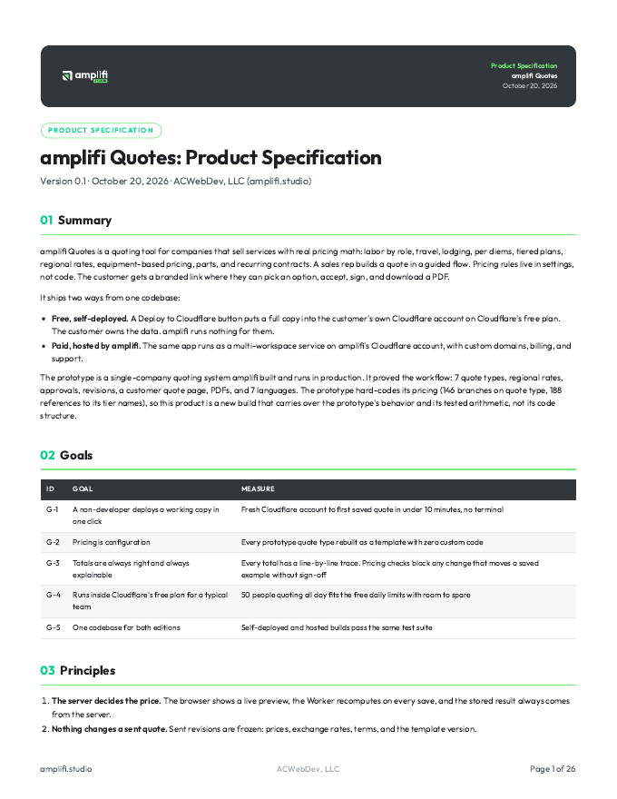
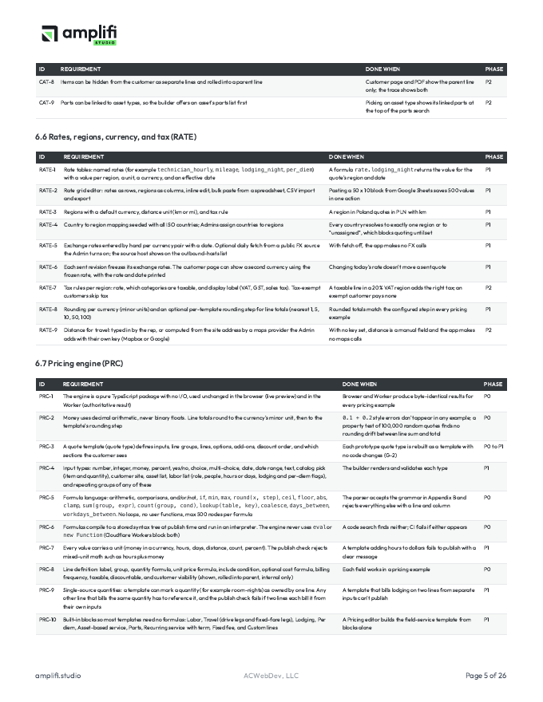
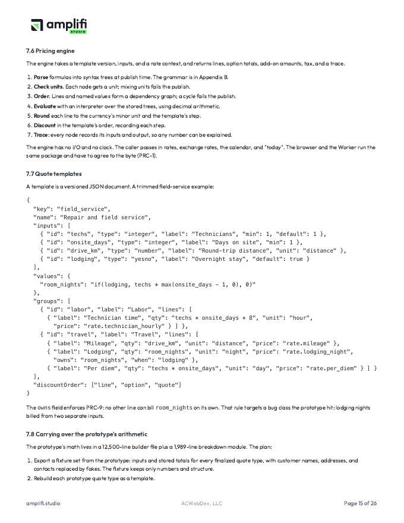
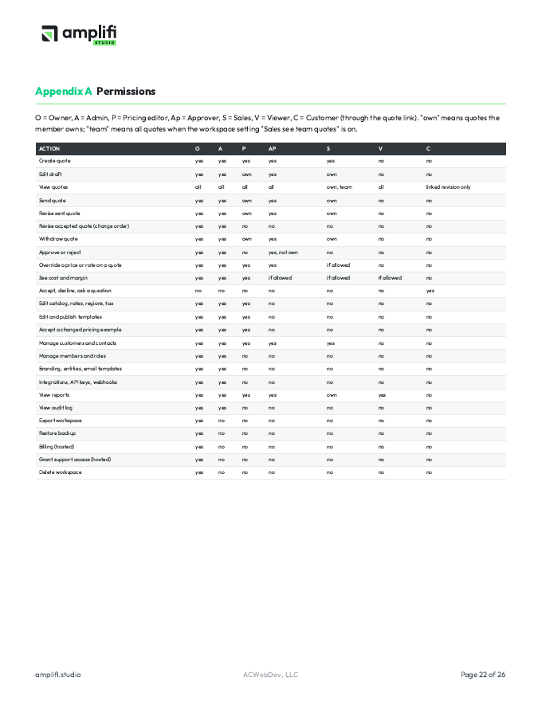

<!-- markdownlint-disable MD033 -->
# amplifi Quotes

Quoting for service businesses with real pricing math: labor by role, travel, lodging, per diems,
tiered plans, regional rates, equipment-based pricing, parts, and recurring contracts. Pricing rules
live in settings, not code. Your customer gets a branded link where they pick an option, accept, sign,
and download a PDF.

Runs entirely on Cloudflare Workers, on Cloudflare's free plan for most teams.

[](https://deploy.workers.cloudflare.com/?url=https://github.com/abchiaravalle/amplifi-quotes)
[](https://github.com/abchiaravalle/amplifi-quotes/actions/workflows/ci.yml)

> **Status: in active development.** The specification is complete and the build is under way in
> public. The Deploy button works once version 1.0 ships. Screenshots below come from the automated
> test run and update as screens land.

## Screenshots

<!-- screenshots:start -->
_Screens land here as each part of the app is built. They're captured by the test suite
(`npm run screenshots`), not mocked up._
<!-- screenshots:end -->

### The specification

<p>
<a href="docs/amplifi-Quotes-Spec-v0.1.pdf"></a>
<a href="docs/amplifi-Quotes-Spec-v0.1.pdf"></a>
</p>
<p>
<a href="docs/amplifi-Quotes-Spec-v0.1.pdf"></a>
<a href="docs/amplifi-Quotes-Spec-v0.1.pdf"></a>
</p>

## Two ways to run it

| | Self-deployed | Hosted by amplifi |
|---|---|---|
| Price | Free | Paid plans |
| Where it runs | Your own Cloudflare account | amplifi's Cloudflare account |
| Your data | Stays in your account. The app sends nothing to amplifi | Processed by amplifi under a data processing agreement |
| Setup | One click, plus a setup code you choose | Sign up |

## What it does

- **Pricing as settings.** Catalog, labor roles, rates by region, currencies, tax, and a small formula
  language. Ready-made blocks (labor, travel, lodging, per diem, asset-based service, parts, recurring)
  cover most quotes without formulas.
- **Totals you can explain.** Every number on a quote keeps a line-by-line trace of how it was built.
- **Pricing checks.** Save known-good example quotes. A pricing change that moves one can't publish until
  someone signs off on the new number.
- **Options and add-ons.** Good/better/best options side by side, optional add-ons the customer ticks,
  discounts at line, option and quote level.
- **Approvals.** Rules for discount, margin, total, overrides, or specific items.
- **Customer page.** Branded link, accept and sign, acceptance certificate, questions thread, PDF made
  in the browser.
- **No passwords.** Passkeys and email sign-in links.
- **No telemetry.** The self-deployed edition makes no outbound calls unless you turn a feature on. The
  settings page lists every host the app can contact.

The full specification is in [SPEC.md](SPEC.md) (also as a [PDF](docs/amplifi-Quotes-Spec-v0.1.pdf)).

## Development

Requires Node 22 or later.

```sh
npm install
npm run build      # typecheck, lint, every test, dry-run deploy, bundle checks
npm run test:e2e   # browser tests in Chromium, WebKit and Firefox against a local Worker
npm run verify     # both
```

One failing test fails the build. CI runs the same gate on every push and pull request, plus a
requirement coverage check, a dependency audit, and a license check.

| Path | Holds |
|---|---|
| `src/engine` | Pricing engine. Pure TypeScript, runs in the browser and the Worker |
| `src/shared` | Code shared by server and browser: permissions, the customer document model, labels |
| `src/worker` | Worker entry, the per-workspace Durable Object, modules, migrations |
| `src/web` | React app and the customer quote page |
| `tests` | Unit, Worker (runs inside workerd), and web tests |
| `e2e` | Playwright browser tests |
| `docs` | Spec sources, API contracts, build brief |

## License

[Elastic License 2.0](LICENSE). You can use, change, and self-deploy it for free. You can't offer it to
others as a hosted or managed service.

## Security

See [SECURITY.md](SECURITY.md) to report a vulnerability.
